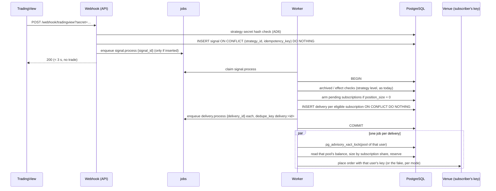

# Design: Multi-user

DESIGN, 2026-10-21. Base `main` at `2e137f1`. Builds on `proposal.md` and `owner-decisions.md` (R1-R7, decisions 1-12). Paths are relative to `backend/src/strategy_manager/` unless they start with `frontend/` or `backend/migrations/`.

## Where the code assumes one user

This map was read on 2026-10-21. Each line below is a place the design has to change.

| Area | Today | Evidence |
| --- | --- | --- |
| Auth | One shared bearer token; the endpoint gets no identity | `shared/infrastructure/admin_auth.py:46-99`, applied on 9 routers |
| Cloudflare | Nothing reads the Access JWT; only `CF-Connecting-IP` for the webhook | `signals/infrastructure/auth.py:36` |
| Keys | One active row per exchange | `ux_exchange_credentials_one_active_per_exchange`, `accounts/infrastructure/models.py:132-137` |
| Pools | Primary key `(exchange, venue, settlement_currency)` | `accounts/infrastructure/models.py:36-38` |
| Strategies | Name unique across all; FK to one pool; `allocation_percent` on the strategy | `strategies/infrastructure/models.py:32-47`, migration 0007 |
| Webhook | One global secret; the strategy is named by `signal_type` (a UUID) | `signals/infrastructure/router.py:115-167` |
| Signals | `UNIQUE(strategy_id, idempotency_key)`; one outcome per signal | `signals/infrastructure/models.py:23-53` |
| Reservations | `signal_id UNIQUE`: one reservation per signal | `allocation/infrastructure/models.py:39-41` |
| Processing | One signal, at most one `allocate()` and one `place()` | `signals/application/process_signal.py:618-647` |
| Lock | `LockKey(exchange, venue, ccy)` hashed with `hashtext` | `allocation/domain/lock_key.py:13-52` |
| Ledger | `UNIQUE(exchange, venue, exchange_fill_id)` | `ledger/infrastructure/models.py:28-33` |
| Mode | `Settings.dry_run`, read in about 20 places; one fake book per exchange | `main.py:568-1738`, `worker.py:160-210` |
| Worker | Opens one key per exchange; `_PoolSet` and `_degraded` keyed by exchange | `worker.py:307-373`, `main.py:694-721, 1005` |
| Reconciliation | Venue net per pool = the whole account | `signals/infrastructure/venue_net_position.py:48-53` |
| Reads | `list_all()` with no owner; every pool listed | `strategies/infrastructure/repository.py:75`, `accounts/infrastructure/pool_overview.py:48-75` |
| Panel | Token in localStorage; badge from unauthenticated `/health` | `frontend/src/shared/auth/token-store.ts:13`, `frontend/src/shared/api/health.ts:17-26` |

Alembic is at revision `0028`. No table has a user column.

## Architecture decisions

### AD1. Identity comes from the Access JWT, validated by the API

**Decision.** A new `identity` module verifies the `Cf-Access-Jwt-Assertion` header on every `/api` request:

- the RS256 signature, against the keys at `https://<team>.cloudflareaccess.com/cdn-cgi/access/certs`, matched by `kid`;
- `aud` against the application's AUD tag;
- `iss` against the team domain;
- `exp`.

It then reads the `email` claim. Source: https://developers.cloudflare.com/cloudflare-one/access-controls/applications/http-apps/authorization-cookie/validating-json/ (read 2026-10-21).

That page recommends the header over the `CF_Authorization` cookie. Its examples read `payload.email`, but it does not document the claim. So the first sign-in rehearsal (task D.2) confirms the claim on a real token, for both one-time PIN and Google.

**Rationale.** The tunnel already validates the token. But the API must not trust a header it cannot verify: a request that reaches the API port by any other path would otherwise choose its own identity.

The keys are cached in process and refreshed on an unknown `kid`, at most once a minute. If they cannot be fetched, `/api` answers 503. The webhook and `/health` do not depend on Access and are unaffected.

**Settings.** New fields:

- `ACCESS_TEAM_DOMAIN`;
- `ACCESS_AUD`;
- `ADMIN_EMAIL`;
- `DEV_USER_EMAIL`, for local runs without Cloudflare.

`model_config` does not change. The API refuses to start, naming the setting:

- with neither Access nor a dev e-mail configured;
- with only one of `ACCESS_TEAM_DOMAIN` and `ACCESS_AUD`;
- with `DEV_USER_EMAIL` beside Access, or when `DRY_RUN=false`;
- with an `ADMIN_EMAIL` or a `DEV_USER_EMAIL` that is not an address.

**Admin.** A user is admin when their e-mail equals `ADMIN_EMAIL`, compared case-insensitively. It is computed, not stored, so the admin is recovered by editing `.env`, never the database.

**The owner's row.** Migration 0029 creates `users` empty. A migration that reads `.env` would tie the schema to a setting, so the owner's row is created like everyone's: by their first `GET /api/me` after the deploy (task A.13 checks it). PR B's 0030 then takes the one user that exists as the owner of the existing data, and refuses unless exactly one exists.

**Layers.**
- domain: `identity/domain/user.py` (`User`, `Mode`), with no framework.
- application:
  - `ResolveUser` finds or creates the user by e-mail and updates `last_seen_at` at most once a minute;
  - `ports.IdentityVerifier`.
- infrastructure:
  - `AccessJwtVerifier` (PyJWT with `cryptography`, a new dependency, pinned);
  - `SqlAlchemyUserRepository`;
  - the FastAPI dependency `current_user`, which replaces `require_admin_token`;
  - the dependency `require_admin`.

### AD2. Ownership is a column on every owned row, backfilled to the owner

**Decision.** Ownership is a `user_id UUID NOT NULL REFERENCES users(id)` column, added to:

- `exchange_credentials`;
- `capital_pools`;
- `pool_balance_snapshots`;
- `reservations`;
- `execution_attempts`;
- `ledger_entries`;
- `reconciliation_discrepancies`;
- `booking_proposals`.

`strategies` gets `author_id`. `signals` gets nothing: a signal belongs to the strategy, and the strategy has an author.

**Rationale.** Each row could reach its owner through joins. A column is still the only form a query cannot forget: a repository method that takes `user_id` and filters on it is testable on its own. The ledger needs the column for its uniqueness anyway (AD5).

**Constraints that change:**
- `ux_exchange_credentials_one_active_per_exchange` becomes `(user_id, exchange) WHERE is_active` (R1).
- `capital_pools` gets a surrogate `id INTEGER` (identity) as its primary key, plus `UNIQUE(user_id, exchange, venue, settlement_currency)`. Every pool FK (strategies excepted, see AD3) moves to `pool_id`.
- The strategies FK is composite on `(exchange, venue, settlement_currency)`, which stops being unique once pools carry `user_id`. So 0030 drops it and adds AD3's CHECK, one migration earlier than first planned (PR B planning, 2026-10-21). A temporary unique on the three columns was the alternative: it would refuse a second user's pool and need undoing in 0031. Creating a strategy still checks that the pool exists.
- `reconciliation_discrepancies`' open-row unique gains `user_id`.
- `strategies.name` stays unique across everyone. Every strategy is public, and two "BTC Trend" entries in one list would let one author pass for another.

**The append-only ledger.** The backfill must not UPDATE the ledger. The migration inserts the owner's user first. It then adds the column as `ADD COLUMN user_id uuid NOT NULL DEFAULT '<owner id literal>'`. On PostgreSQL 11+, a constant default is stored in the catalogue and no row is rewritten, so the append-only triggers never fire. The default is dropped in the same migration. The other tables receive their owner the same way, since it costs nothing and rewrites nothing (B.1).

### AD3. A strategy names a market; a subscription names a pool

**Decision.**
- `strategies` keeps `exchange`, `venue` and `settlement_currency`, which say where it trades. It loses its FK to `capital_pools`, because pools now belong to users, and gains a CHECK against the known pools.
- `allocation_percent` moves to `subscriptions`.

```
subscriptions
  id              uuid pk
  user_id         uuid  -> users
  strategy_id     uuid  -> strategies
  pool_id         int   -> capital_pools     -- the subscriber's pool for the strategy's market
  allocation_percent numeric  CHECK (> 0 AND <= 100)
  status          ACTIVE | LEAVING | ENDED
  armed_at        timestamptz NULL           -- decision 3, see AD4
  created_at, left_at, ended_at
  UNIQUE (user_id, strategy_id) WHERE status <> 'ENDED'
  CHECK pool_id belongs to user_id and matches the strategy's market (enforced in the use case and by a trigger)
```

The author trades their own strategy only by subscribing to it, like anyone else. The migration gives the owner one ACTIVE, armed subscription per existing strategy, at its current `allocation_percent`.

**Rationale.** Decision 3 makes the share belong to the subscriber's money. Kept on the strategy, it would be the author's number applied to everyone.

**Layers.**
- domain: `subscriptions/domain/subscription.py` holds the lifecycle and its legal transitions (a new top-level module, by the screaming rule).
- application: `Subscribe`, `Leave`, `ChangeShare`.
- infrastructure: repository and router.

### AD4. The lifecycle: joining at the next opening, leaving after the close

**Joining (decision 3, revised by decision 18).** Decision 18 replaces the arming below, which applied to the whole strategy, with a per-symbol rule:
- Every consuming effect, whether an opening from flat or the opening half of a reverse, goes to every ACTIVE subscription.
- A releasing effect goes only to the subscriptions that hold that symbol's open allocation.
- `armed_at` is not built. The original text follows, for the record.

A subscription opens only once it is **armed**. It is armed at creation when the strategy is flat, meaning the last processed signal of the strategy reported `position_size = 0`, or no signal exists yet. Otherwise it is armed by the first processed signal that reports `position_size = 0`.

`position_size` is the strategy's own position as TradingView reports it (`signals/domain/alert.py:148`). So arming does not depend on any account, and every subscriber enters on the same signal as the author.

**Leaving (decision 4).**
- `Leave` sets `LEAVING` when the subscriber holds an open allocation from this strategy, and `ENDED` otherwise.
- A `LEAVING` subscription gets deliveries for closing effects only.
- When its last allocation closes, it becomes `ENDED` in the same transaction.

**Disable and archive (decision 5).** These are unchanged: the disabled check sits in allocation (`allocation/application/allocate_capital.py:125-187`), so closes still flow.

Archiving now requires that **no subscriber** holds an open allocation. Archiving ends every subscription.

To check during apply: how `process_signal.py` derives the effects (consumes or releases) from `contracts` and `position_size`. Arming reads the same field and must agree with it.

### AD5. One signal fans out into one delivery per subscription

```
signal_deliveries
  id               uuid pk
  signal_id        uuid -> signals
  subscription_id  uuid -> subscriptions
  user_id          uuid -> users
  status, outcome_reason, outcome_detail, decided_at   -- moved from signals, per subscriber
  UNIQUE (signal_id, subscription_id)
```



**Eligibility, read inside the fan-out transaction:**
- An **opening** effect goes to ACTIVE subscriptions that are armed.
- A **closing** effect goes to ACTIVE or LEAVING subscriptions holding an open allocation of the strategy.
- A REVERSE is a close followed by an open. Both halves are evaluated per subscription, as today, with `signal.open_after_close` carrying `delivery_id`.

**Idempotency.**
- A retried `signal.process` hits `UNIQUE(signal_id, subscription_id)` and the job `dedupe_key`, so it makes no second delivery and no second job.
- `reservations.signal_id UNIQUE` becomes `reservations.delivery_id UNIQUE`.
- `client_order_id` stays a fresh UUID4 per attempt, and it is scoped by the venue account.

**Ledger.** `ux_ledger_exchange_fill` becomes `(user_id, exchange, venue, exchange_fill_id)`. On Binance, two of our users on opposite sides of one trade share the venue's trade id. Without the user in the key, the second fill would be refused as a duplicate with no log line.

**Every job that carried `signal_id`** for one execution carries `delivery_id` instead:
- `signal.open_after_close`;
- the settle path through the attempt.

**Latency.** Deliveries are independent jobs. Whether they run in parallel depends on how many jobs the worker claims at once, which is **unverified**. Task D.3 measures one signal fanned out to 20 simulated subscriptions before sign-up opens. If the worker turns out to be serial, its concurrency is raised then. The lock is per pool, so parallel deliveries never contend.

**Layers.**
- application:
  - `FanOutSignal` (in `signals/application`);
  - `ProcessDelivery`, which is today's `ProcessSignalHandler` body taking a delivery.
- infrastructure:
  - the `SqlAlchemyDeliveryRepository`;
  - the `delivery.process` job kind.

### AD6. The webhook secret is per strategy, stored as a hash

**Decision.**
- `strategies.webhook_secret_hash` holds a SHA-256 of a 32-byte random secret.
- The secret is shown to the author once, when the strategy is created or the secret is regenerated.
- The webhook compares the hash in constant time. It reads the strategy row by primary key, one indexed read, well inside TradingView's 3 seconds.
- The IP allowlist stays global.

**Migration.** Today's three strategies get the hash of the current global `WEBHOOK_SECRET`, so their TradingView alerts keep working unchanged. `GET /api/webhook-secret`, which reveals the global secret, is removed once the panel shows the per-strategy flow.

**Rationale.** With one shared secret, any author who learns another strategy's UUID could post its signals. Strategy UUIDs appear in panel URLs, so they are not secret. A hash means a database dump reveals no secret that could post signals.

This adds one database read to the webhook. That revisits operator-panel decision 11 ("no database lookup is added to the webhook"), which was about the archived check. That decision still holds: the archived refusal stays in processing.

### AD7. The mode belongs to the user; `.env` is the brake

**Decision.** The effective mode of a delivery is LIVE only if:

- `.env` `DRY_RUN` is false;
- the user's `mode` is `LIVE`.

It is recorded on the reservation as `mode` at open.

```mermaid
sequenceDiagram
    participant U as User (panel badge)
    participant API
    participant DB

    U->>API: POST /api/me/mode {LIVE}, after confirmation
    API->>DB: BEGIN; SELECT user FOR UPDATE
    API->>DB: any active trade-capable key for this user?
    alt none
        API-->>U: 409 MODE_LIVE_NEEDS_TRADE_KEY
    else
        API->>DB: UPDATE users SET mode = LIVE; COMMIT
        API-->>U: 200
    end

    U->>API: POST /api/me/mode {SIMULATION}, after confirmation
    API->>DB: BEGIN; SELECT user FOR UPDATE
    API->>DB: open LIVE reservations or SUBMITTED live attempts for this user?
    alt some
        API-->>U: 409 MODE_SIMULATION_NEEDS_FLAT + the list
    else
        API->>DB: UPDATE users SET mode = SIMULATION; COMMIT
    end
```

**The race with an opening delivery.** `ProcessDelivery` reads the user's mode under a `FOR SHARE` lock on the user row. It takes that lock **after** the pool advisory lock, keeping the order of the working agreement: the advisory lock first, then row locks. So a flip to simulation either waits for an opening already in flight, or makes it run in simulation. It never lets a real reservation appear after the flat check passed. Task B.4 proves this with the lock-hold harness on real PostgreSQL.

**Adapters.** `exchange_for(session)` becomes `exchange_for(session, user, mode)`:
- LIVE loads **that user's** vault key for the exchange;
- SIMULATION returns that user's fake, a `FakeVenueBook` keyed by `(user_id, pool)`.

The fakes stay process-lifetime, as today.

**Closes follow the open (decision 14).** A closing delivery runs in the `mode` recorded on the reservation it closes, whatever the brake or the user's current mode say. So `exchange_for` is called with the reservation's mode for a close, and with the effective mode for an open.

**Startup guard.** `assert_dry_run_matches_ledger` (`main.py:777-797`) no longer refuses `DRY_RUN=true` while real allocations are open; decision 14 makes that a valid state. What it still refuses is a real open allocation whose user has no active trade-capable key, because that close could not run. Its message names the users by id and how many allocations each holds.

### AD8. Every read and write is scoped, and checked across users

- Every repository method that reads owned rows takes `user_id`. No unscoped `list_all()` remains outside admin use cases. Admin use cases live in `admin/application` and depend on `require_admin`.
- A resource of another user answers **404, not 403**, so its existence is not disclosed.
- **Test rule.** Each endpoint gets one cross-user test: user B requests user A's resource by id and receives 404, and no row changes. This is the check that catches a missing filter. The gate cannot.

**Public reads** are the one deliberate exception:
- the strategy list and a strategy's public page (decision 9);
- the author's aggregates, which only the author receives (decision 10: a count, the live count, and the sum per settlement currency, never per subscriber).

### AD9. The worker works per (user, exchange)

- **Balance sync.** It runs one `SyncBalances` per `(user, exchange)` with an active key.
  - A failure degrades only that pair.
  - `_degraded` is keyed by `(user_id, exchange)`.
  - `read_key_coverage` returns sets of `(user_id, exchange)`, still in one statement.
- **Startup.** The worker still refuses to start if any active key fails to open. A key that does not decrypt means a wrong master key or a corrupt row, never a user's mistake: the API seals every key with the same master key. So refusing protects every user at once.
- **Telegram.** It stays the admin's channel. A user's alert names the user's id prefix, not their e-mail, so no personal data goes to Telegram.
- **Rate limits.** The VPS has one IP, and Binance counts request weight per IP. Task D.3 checks the weight of one balance sync against the published limit for 50 users before sign-up opens.

### AD10. Reconciliation and the holding guard are per user's pool

- The venue's net position is read with **that user's** key, so it is that user's account.
- The ledger side is filtered by `user_id`. Classification and auto-booking are unchanged.
- Discrepancies carry `user_id`, and the admin's view shows the user's e-mail beside each row.
- A user who holds two strategies on one symbol and pool gets AMBIGUOUS, as several strategies sharing a pool do today.

### AD11. The panel

- **Sign-in.** `TokenGate` and `sm.admin_token` are removed; Access signs the user in before the page loads. `GET /api/me` returns:
  - `email`;
  - `is_admin`;
  - `mode`;
  - `dry_run_brake`;
  - the user's keyed exchanges.
- **The badge** (`frontend/src/shared/layout/DryRunBadge.tsx`) reads `/api/me` and opens a confirmation. With the brake on, it shows that simulation is forced for everyone and cannot be clicked.
- **Navigation.**
  - Discrepancies and Users show only when `is_admin`. The server enforces this anyway.
  - Strategies gains "My subscriptions", "Explore" (the public list) and "Authored".
- **Copy.** The ES copy uses "usted" and "clave".
- **Settings.** It is per user, and it tells the user to restrict their key to the VPS's IP on the exchange. That limits the harm of a leaked key, now that the system holds strangers' keys.
- **Local review.** `vite.fixture.config.ts` and `npm run dev` work through `DEV_USER_EMAIL`.

## Migration plan

| Rev | What | Downgrade |
| --- | --- | --- |
| 0029 | `users`, empty; the owner's row is created by their first `GET /api/me` | drop `users` |
| 0030 | `user_id` on owned tables (AD2; ledger by constant default), filled with the one existing user (refuses unless exactly one exists); keys' unique per user; pools' surrogate id and FK moves; strategy's pool FK dropped for AD3's CHECK; ledger fill unique with `user_id` | reversible while only the owner exists |
| 0031 | `subscriptions`; one per existing strategy for the owner; `allocation_percent` copied, then made nullable on `strategies` and dropped by 0033 (expand and contract, `tasks.md` PR C) | reversible while only the owner exists |
| 0032 | `signal_deliveries`; one per existing signal for the owner's subscription; `reservations.delivery_id` backfilled, `signal_id UNIQUE` dropped | reversible while only the owner exists |
| 0033 | `strategies.webhook_secret_hash` (the current global secret hashed by the migration from settings); `users.mode` (the owner's set to `LIVE` if `DRY_RUN=false` at migration time, else `SIMULATION`); `reservations.mode` backfilled from each row's recorded mode origin | reversible while only the owner exists |

- Each migration is rehearsed on a throwaway database restored from a fresh production backup, before production migrates.
- "Reversible while only the owner exists" means: after a second user has data, a downgrade drops that data, so the plan is fix-forward from then on.
- The owner's mode is backfilled so that production keeps trading exactly as before the deploy. To check during apply: the source of each reservation's mode, which `execution/domain/mode_origin.py` suggests.

## Delivery

Sequential PRs, each cut from `main`. Every PR ships while Access admits only the owner, so production stays single-user until the last step.

| PR | Contents | Owner-run step |
| --- | --- | --- |
| A | AD1 identity, `/api/me`, panel without the token | set `ACCESS_TEAM_DOMAIN`, `ACCESS_AUD`, `ADMIN_EMAIL` in `.env`; rehearse 0029 |
| B | AD2 ownership, AD8 scoping and cross-user tests, AD9 worker per user, AD10 | rehearse 0030 |
| C | AD3-AD5 subscriptions and fan-out | rehearse 0031-0032 |
| D | AD6 per-strategy secret, authoring for any user | rehearse 0033 (secret part) |
| E | AD7 mode per user and the badge | rehearse 0033 (mode part) |
| F | Public strategy list (decision 9, OQ3), author aggregates (decision 10), admin users list (decision 8) | none |
| G | Readiness: D.1-D.4 below | open the Access policy, turn on seat expiration |

**Readiness tasks before sign-up opens:**
- **D.1.** A cross-user sweep: every `/api` route is listed from the app, and each one has its cross-user test.
- **D.2.** A real Access token for a second e-mail, by one-time PIN and by Google. Check the `email` claim, that the user is created, and that the user sees nothing of the owner's.
- **D.3.** Fan-out latency for 20 simulated subscribers, and the Binance weight of one balance sync for 50 users.
- **D.4.** The CLAUDE.md rules that change are rewritten:
  - rule 4: the lock is keyed by pool, which includes the user;
  - "one key per exchange" becomes per user;
  - the credentials section.

Every PR follows strict TDD and the gate. Concurrency (AD7's mode race, AD5's per-pool lock) is proven on real PostgreSQL with the lock-hold harness.

## Open questions (product; asked one at a time)

**OQ1. What a user in simulation trades against. Answered: decision 13.**
- Answer: their real balance, read with their own key. A read-only key is enough.
- `Subscribe` therefore requires an active key, of any capability, on the strategy's exchange.
- To check during apply: how balance sync behaves under `DRY_RUN` today.

**OQ2. What the `DRY_RUN=true` brake does to a real position already open. Answered: decision 14.**
- Answer: the brake stops real openings only. A real allocation closes for real, in the mode recorded at its open (AD7).

**OQ3. What "the strategy's return" in the public list measures. Answered: decision 15.**
- Answer: a record taken from the signals: the alert prices, unleveraged, before fees. The live subscriber count is shown beside it.
- Each closed trade pairs an opening signal with the signal that closes it, using `price` (`signals/domain/alert.py:149`). The public record never reads the ledger.
- It is a read-only projection, in `performance/application`.
